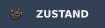
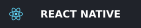
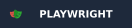

<h1 align="center">Hi, I'm Zahidul Islam Joy 👋</h1>

  <b>Senior Software Engineer</b>

  
  
  

 

## About me

- 🏢 Senior Software Engineer at **[Tixio](https://tixio.io)** and **[Vadio](https://vadio.no/en)**, both remote from Norway
- ⚡ 5+ years shipping production SaaS used daily by teams worldwide
- 🛠️ Crafting high-performance SaaS products for web, mobile and desktop
- 🌱 Currently exploring RAG pipelines, AI agents and DevOps
- 🎓 B.Sc. in Industrial and Production Engineering, BUET
- 📍 Sylhet, Bangladesh

 

## Tech stack

**Frontend**

      

**Backend**

    

**Realtime**

 

**Mobile and desktop**

  

**AI**

   

**Testing**

  

**Delivery**

  
